<p align="center">
  
</p>


<p align="center"><em>Fem un vermut?</em></p>

A street that needs cleaning, a pavement in need of repair, a question about
paperwork: everyday contact with the council offers a particular view of life
in Barcelona. IRIS records incidents, complaints, suggestions, inquiries, and
messages of gratitude. Read together, they let us ask when people report,
what they contact the council about, and which requests appear in the published data.

The plots below tell that story one step at a time. Each has a short guide to
reading it, an interpretation grounded in the numbers, and an explanation of
what it can mean for city life. The limits stay beside the findings, where
readers can judge them.

IRIS measures **reported citizen activity**. It does not capture every urban
issue, establish causation, or directly measure service quality.

## Open the work

- **[Illustrated reading guide](reports/iris_signal_summary.md)** — findings,
  all 13 plots, an individual interpretation for each, and supporting tables.
- **[Standalone report](reports/iris_exploration.html)** — open the downloaded
  file in a browser. It contains all charts and 13 downloadable aggregate CSV
  tables, works offline, and can be shared as one file. GitHub displays the
  source; download the file to view the rendered report.
- **Local explorer:** `.venv/bin/python -m streamlit run streamlit_app.py`.
  Filter dates, request areas, districts (including missing), and channels;
  inspect sample records and download the filtered aggregate tables.
- **[Category and observation decisions](reports/iris_category_decisions.md)**
  explain the closure-year selection, source label changes, and denominators.

## New check: follow the requests into the next year

**December's observed count rises by 34.2% when we include later closures.**
The 2026 snapshot adds **6,419 requests registered in 2025**, bringing the
combined observed group to **285,047**. Of those additions, **5,331** were
registered in December: its count rises from **15,600 to 20,931**.

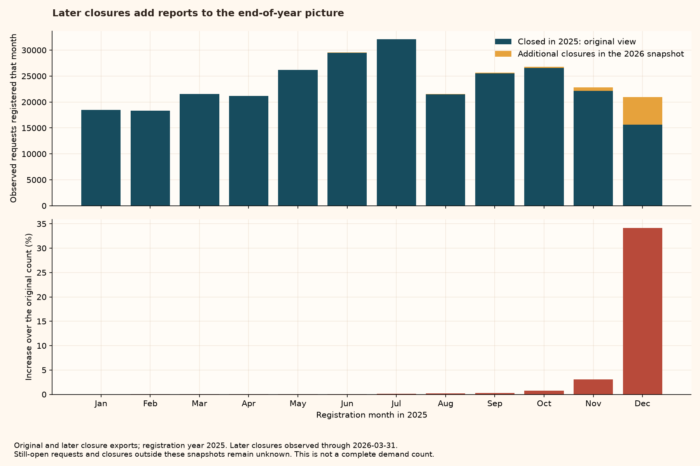

The blue bars show the original counts; gold shows the additional reports.
The lower bars show the percentage increase over each original monthly count.
A request does not stop mattering at New Year, but it can fall outside an
annual closure file. This check makes that limitation visible in actual numbers.

Although downloaded on **2 October 2026**, the new file contains closures only
through **31 March 2026**. We now have documented 30-day and 90-day follow-up
rules: each registration date gets the same allowed time for a closure to
appear. These are counts of observed requests closed within those periods,
not counts of all requests made or estimates of successful resolution.

Read the [observation-window audit](reports/iris_observation_windows.md) for
monthly counts, source checks, category changes, and the exact inclusion rules.
The original 13 plots below still describe **278,628 requests registered and
closed in 2025**; the new comparison is separate so the two groups are not confused.

## The original 2025 view

Discovery and conservative preparation are complete for one locally preserved
2025 IRIS export. The descriptive exploration now has reproducible plots,
aggregate tables, an illustrated report, and an existing local viewer with
consistent calculations. The original download is preserved. The catalog was checked again on
2026-10-02 for the separate follow-up audit above.

| Stage | Records | Meaning |
| --- | ---: | --- |
| Original export | 287,304 | All original rows, including exact duplicates |
| Exact duplicate rows removed | 3,393 | No other deduplication or imputation |
| Prepared records | 283,911 | All observed closure dates are in 2025 |
| Earlier registrations | 5,283 | Retained in the prepared file; outside headline charts |
| Headline cohort | 278,628 | Registered **and** closed in 2025 |

**The headline cohort is not a complete count of requests registered in 2025.**
Requests still open or closed in another year are absent. A late-December
registration must close quickly to appear in this file. Falling year-end
counts or lags cannot establish falling demand or faster service.

<!-- BEGIN IRIS PLOT READINGS -->

## A walk through the plots

Start with the bold takeaway below each plot. Then read how the chart works, what the numbers show, and why it matters. The last paragraph explains what we cannot conclude. This keeps evidence, explanation, and everyday human context together: ethos, logos, and pathos. Examples describe possible situations, not individual people identified in the data.

#### A few words, explained simply

| Word                                   | Plain meaning                                                                                                                                                             |
| -------------------------------------- | ------------------------------------------------------------------------------------------------------------------------------------------------------------------------- |
| Request / report                       | One entry sent to the council and published in IRIS: for example an incident report, complaint, inquiry or suggestion. Several entries can concern the same issue.        |
| Cohort                                 | The group we chose to study: here, requests registered and closed in 2025.                                                                                                |
| Registration date                      | When a request entered the system; the issue may have started earlier.                                                                                                    |
| Time until marked closed (closure lag) | Calendar days between a request entering IRIS and its recorded closing date. Marked closed is an administrative status; it does not prove the underlying issue was fixed. |
| Median                                 | The middle value when values are put in order. At least half are at or below it.                                                                                          |
| 95th percentile                        | A value that at least 95 out of 100 observed values do not exceed; about 5 out of 100 are higher.                                                                         |
| Share / percentage                     | How many out of every 100 records in the stated group. A larger share need not mean more reports.                                                                         |
| Correlation                            | A score from −1 to +1 for how two quantities move together in a straight-line pattern. Near zero means little such pattern, not proof of no relationship.                 |

All thirteen plots are shown below. Follow the story in order, or jump to a reading:

- [1. When residents submit requests to the council](#1-when-residents-submit-requests-to-the-council)
- [2. More requests are registered on weekdays](#2-more-requests-are-registered-on-weekdays)
- [3. How request counts vary by month and weekday](#3-how-request-counts-vary-by-month-and-weekday)
- [4. Why late-year requests are missing from this view](#4-why-late-year-requests-are-missing-from-this-view)
- [5. Cleaning and street maintenance account for most requests](#5-cleaning-and-street-maintenance-account-for-most-requests)
- [6. Almost one in three requests has no recorded district](#6-almost-one-in-three-requests-has-no-recorded-district)
- [7. Some request categories have much less location information](#7-some-request-categories-have-much-less-location-information)
- [8. What types of requests are recorded in each district](#8-what-types-of-requests-are-recorded-in-each-district)
- [9. How requests reach the council: mobile, web and telephone](#9-how-requests-reach-the-council-mobile-web-and-telephone)
- [10. How many days pass before a request is marked closed](#10-how-many-days-pass-before-a-request-is-marked-closed)
- [11. Time until a request is marked closed varies by category](#11-time-until-a-request-is-marked-closed-varies-by-category)
- [12. Daily request counts and time until closure](#12-daily-request-counts-and-time-until-closure)
- [13. Changing category names can mislead comparisons over time](#13-changing-category-names-can-mislead-comparisons-over-time)

### 1. When residents submit requests to the council

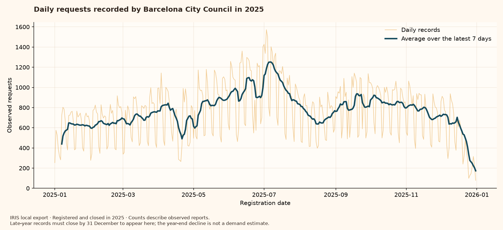

**Takeaway: Report counts change through the year and repeatedly rise and fall within each week.**

*How to read it: The gold line counts records by registration date; the blue line averages seven complete calendar days so the broader movement is easier to see.*

The line rises and falls repeatedly through a year containing 278,628 reports. The median day has 784; the largest daily count is 1,572, on 3 July. The repeated rises and falls suggest checking weekday patterns before treating a busy day as an unusual event.

Submitting a request is one way to bring an everyday concern to the council's attention. Seen together, these records show when that contact enters IRIS. The blue line helps us follow the changing pace without letting a single busy day dominate the story.

A registration date tells us when a request entered the system, not when the underlying issue began. Only requests closed in 2025 appear here, so the fall near December cannot by itself show that the city needed less help.

### 2. More requests are registered on weekdays

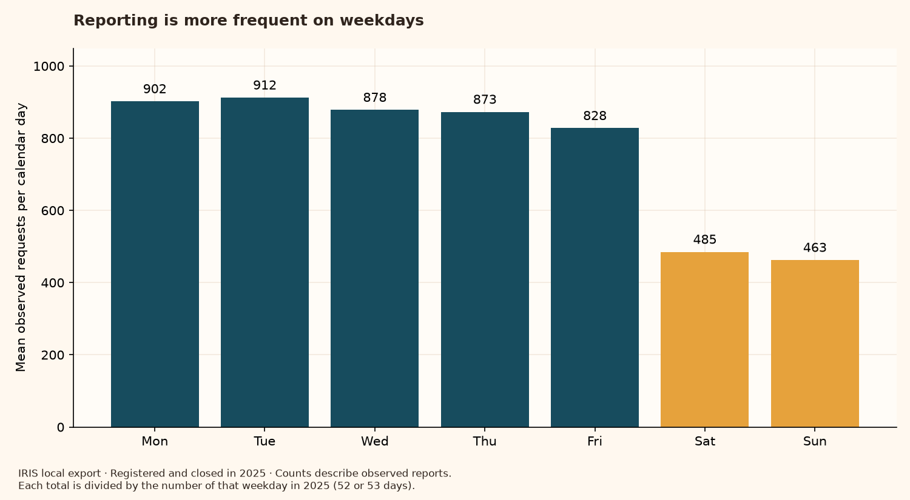

**Takeaway: An average weekday has about 1.85 times the reports of an average weekend day.**

*How to read it: Each bar divides that weekday's total by the number of times it occurs in the year: 53 Wednesdays and 52 of each other weekday.*

Weekdays average 879 reports, compared with 474 at weekends: 1.85 times as many. Tuesday has the highest mean (912), and Sunday the lowest (463). The contrast is visible across the working week.

People fit contact with public services around their lives, and municipal channels have their own routines. Those are plausible contributors to this pattern. For someone planning a fair comparison, the practical lesson is to compare a Tuesday with similar weekdays before describing it as unusually busy.

The records do not measure opening hours, people's schedules, or all unreported concerns. A lower Sunday bar does not establish that fewer problems occurred that day, and this chart cannot separate the possible explanations.

### 3. How request counts vary by month and weekday

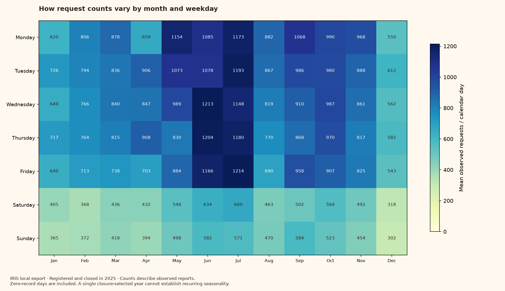

**Takeaway: Compare similar days: a July Friday and a January Friday have different reporting levels in this file.**

*How to read it: Choose a month along the bottom and a weekday on the left. The number in their square is the average daily count for that combination; darker squares mean more reports.*

Fridays in July average 1,214 reports, compared with 640 in January. Weekend cells remain lighter than working-day cells across the year. Together, the two directions show why neither the weekday nor the month alone captures the whole reporting pattern.

For anyone trying to understand a busy day, its place in the calendar matters. Comparing similar weekdays in similar parts of the year gives us a more useful starting point for asking when reports tend to accumulate, without treating every peak as a special event.

Each square averages only four or five days. Holidays and a few unusual days can affect it. We have one year of selected completed records: the heatmap does not establish a repeating seasonal pattern, a tourism effect, or a weather effect.

### 4. Why late-year requests are missing from this view

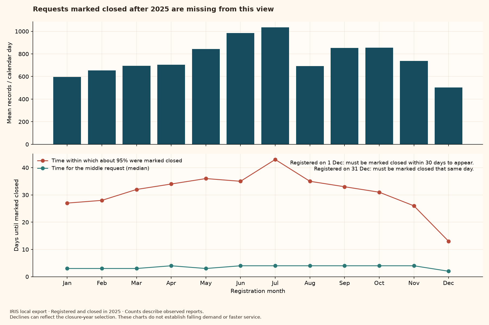

**Takeaway: Late-year requests that closed after 31 December are absent from this file.**

*How to read it: The top panel shows the average number of requests registered per day in each month. The lower panel measures days until requests were marked closed: one line shows the middle time (median), and the other the time within which about 95 out of 100 requests were marked closed.*

The observed daily mean is highest in July, at 1,035; December's is 503. December also has a median lag of 2 days. These lower numbers are tempting to read as less pressure or faster service, but the file has a fixed boundary: every included request closed by 31 December.

Consider a request registered on 1 December. It can appear here with at most 30 days between registration and closure. A request registered on 31 December must close that same day. An unresolved concern can still matter to the person reporting it even when it falls outside this particular export.

This boundary can lower both the observed count and the observed lag late in the year; it does not tell us how much of the decline it explains. We need later closure records and comparable follow-up periods before judging changes in demand or closure speed.

### 5. Cleaning and street maintenance account for most requests

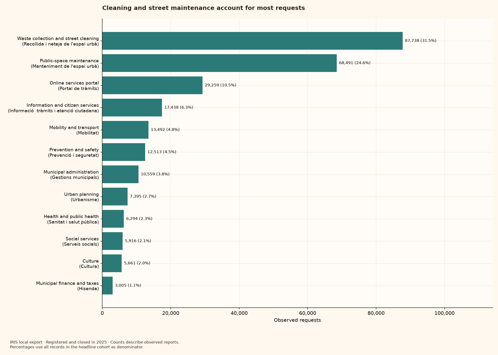

**Takeaway: Cleaning and public-space maintenance make up about 56 out of every 100 reports studied here.**

*How to read it: Each bar shows how many requests concern a particular council service or topic. English labels appear first, followed by the published labels in parentheses. A label of 31.5% means about 32 of every 100 requests in the study; the percentages include categories not shown among these 12 bars.*

Cleaning and collection (Recollida i neteja de l'espai urbà) account for 87,738 reports. Public-space maintenance (Manteniment de l'espai urbà) adds 68,491. Together that is 56.1% of the requests studied: more than half of the records in this view concern these two areas.

Each entry records contact with the council about a service or topic. Cleaning and maintenance concern places people use every day: pavements, streets and other public spaces. Their large share tells us that caring for those places is a major part of the contact recorded in this file. The other bars include inquiries and administrative matters as well as reports of problems.

Frequency is not a measure of severity. Several reports may refer to the same issue, and difficult or poorly reported problems may occupy small bars. The plot describes the published requests, not a ranking of everything that matters to Barcelona's residents.

### 6. Almost one in three requests has no recorded district

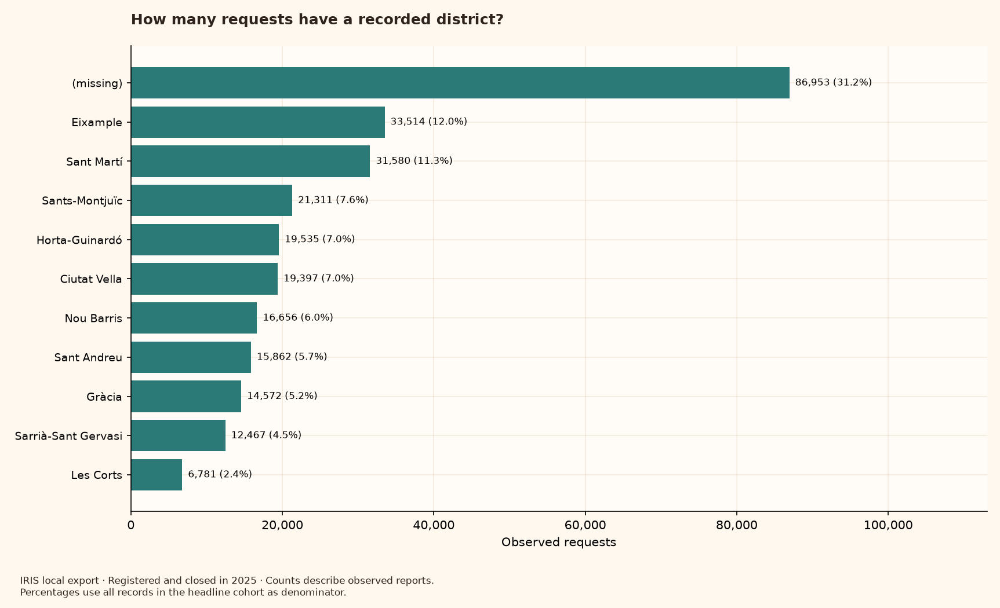

**Takeaway: About 31 out of every 100 reports have no district, so a district-only view leaves many reports out.**

*How to read it: Each bar counts records assigned to a district; the '(missing)' bar counts records without a published district. Percentages refer to the entire headline cohort.*

86,953 reports, or 31.2%, have no district. Among named districts, Eixample has the largest count (33,514). Keeping the missing group in view makes the coverage gap visible before any geographic comparison.

A map can feel like a complete picture of a city. Here, drawing only the records we can place would leave nearly one third of the selected reports outside that picture. Keeping them visible helps us remember that a request can be relevant even when it cannot be assigned to a district.

A higher district count does not establish greater need, more problems per resident, or worse service. Districts differ in population, activity, and reporting habits, and none of those differences has been adjusted for here. Missing district also need not mean the publisher failed to locate a place-specific issue.

### 7. Some request categories have much less location information

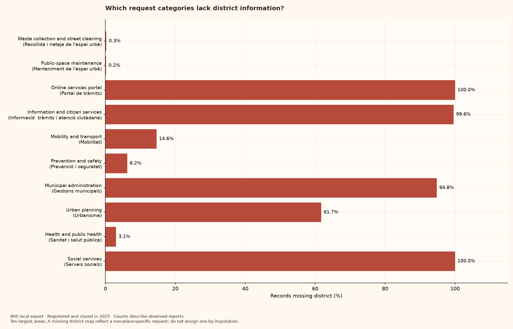

**Takeaway: Removing reports without a district also changes which kinds of concerns we see.**

*How to read it: For each of the ten largest areas, the bar is the percentage of its records without a district. A longer bar means less geographic information, not more requests.*

Only 0.28% of cleaning records and 0.21% of maintenance records lack a district. For the administrative portal (Portal de tràmits), the missing share is 100%. The gap is strongly associated with the kind of request.

A damaged pavement has a physical location; a question about an online procedure may not. That difference is one plausible explanation for the contrast. If we keep only records with a district, we consequently hear much more about physical public space and much less about administrative services.

The file does not establish why any individual location is absent. We should neither invent districts to fill the gaps nor assume that records with a district represent the rest. Geographic filtering changes the question the analysis can answer.

### 8. What types of requests are recorded in each district

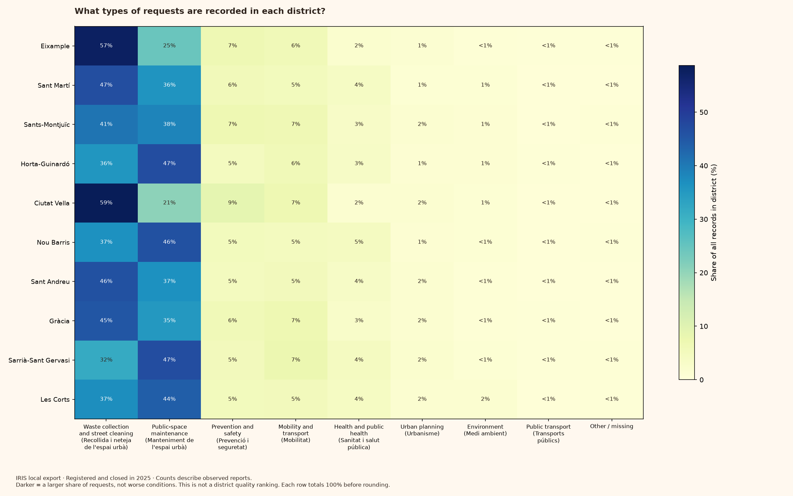

**Takeaway: This compares the topics of requests within each district. It does not rank districts or neighbourhoods from best to worst.**

*How to read it: Each row is a district, not an individual neighbourhood. Read across it as 100 requests assigned to that district: each cell shows how many out of those 100 fall into a request category. Darker means a larger share of reports, not worse living conditions. Each row totals 100% before rounding; English category labels appear above the original names.*

In Ciutat Vella, cleaning accounts for 58.7% of located reports and maintenance for 20.5%. In Horta-Guinardó, the corresponding shares are 35.6% and 47.0%. The balance of these two large categories is visibly different.

This chart answers what people contact the council about in each district. That can help someone preparing a local discussion pay attention to the topics most often raised there. It does not answer which district is the best place to live, which has the cleanest streets, or which provides the best service.

For example, 40 cleaning requests out of 100 total is 40%; the same 40 cleaning requests out of 80 total is 50%. The share increased without any extra cleaning requests. A larger share therefore does not establish dirtier streets, and this chart excludes records with no district. It contains no adjustment for residents, visitors, or willingness and ability to report.

### 9. How requests reach the council: mobile, web and telephone

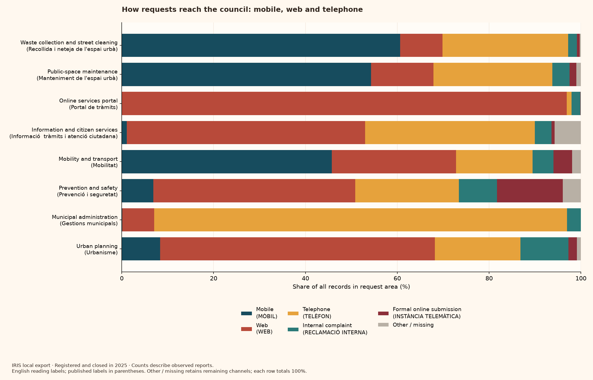

**Takeaway: Street-related reports and administrative questions often reach the council through different channels.**

*How to read it: Each horizontal bar represents all reports in one request area. Read the English labels first; the original published labels appear underneath in parentheses. Its coloured segments show reporting-channel shares; Other / missing preserves the channels outside the five displayed leaders. These are display translations, not merged categories.*

Mobile (MÒBIL) accounts for 60.7% of cleaning reports and 54.3% of maintenance reports. Web accounts for 96.9% of administrative portal requests. Different categories reach IRIS through markedly different routes.

Someone noticing an issue on a street and someone trying to complete an online procedure may approach the council differently. The chart makes that a useful question about access and reporting context. Understanding public concerns also requires understanding the routes by which those concerns become records.

These records do not identify who could not use a channel or why a channel was chosen. Differences may reflect request mix, available services, or administrative routing. They do not establish digital exclusion, citizen preferences, or a causal effect of channel on closure speed.

### 10. How many days pass before a request is marked closed

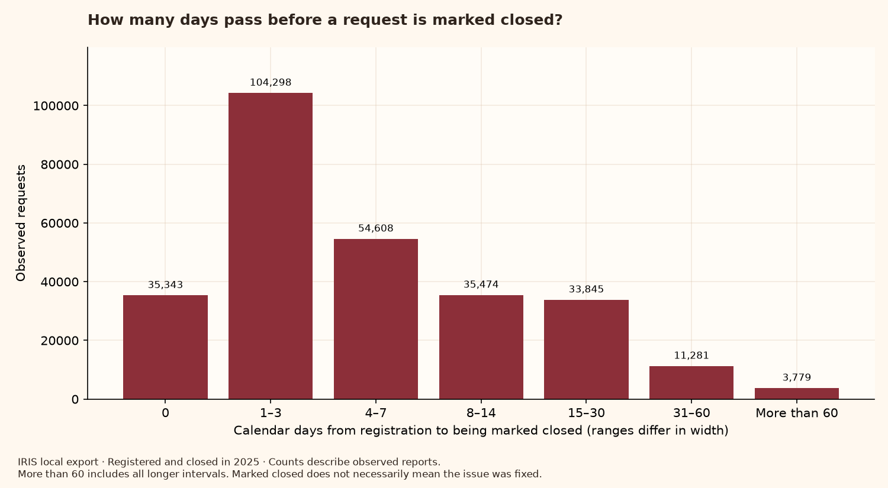

**Takeaway: Half the requests were marked closed within 3 days, but 3,779 took more than 60 days. Marked closed does not necessarily mean the issue was fixed.**

*How to read it: Count calendar days from the date a request entered IRIS to the date it was marked closed. For example, 1 March to 4 March is 3 days; 0 means both dates are the same. Each bar counts requests in the stated range. The final More than 60 bar includes every request taking longer than 60 days, so the ranges are not equally wide.*

Half the requests were marked closed within 3 days. About 95 out of every 100 were marked closed within 32 days. But 3,779 requests (1.4%) took more than 60 days, and the longest interval in this group was 286 days.

A single typical time can hide very different experiences. Some requests stay in the administrative process for weeks or months. Statisticians call this smaller group of much longer times a long tail. Here it is visible in the bars on the right, including More than 60; it is not left out of the chart. Showing it helps us remember the people whose requests took much longer to be marked closed.

Marked closed does not necessarily mean the street was repaired, the question was answered satisfactorily, or the person considered the issue resolved. Still-open requests and requests closed after 2025 are absent, so this chart cannot describe how long every resident waited. The full export's longer maximum of 580 days includes earlier registrations and belongs to a different comparison.

### 11. Time until a request is marked closed varies by category

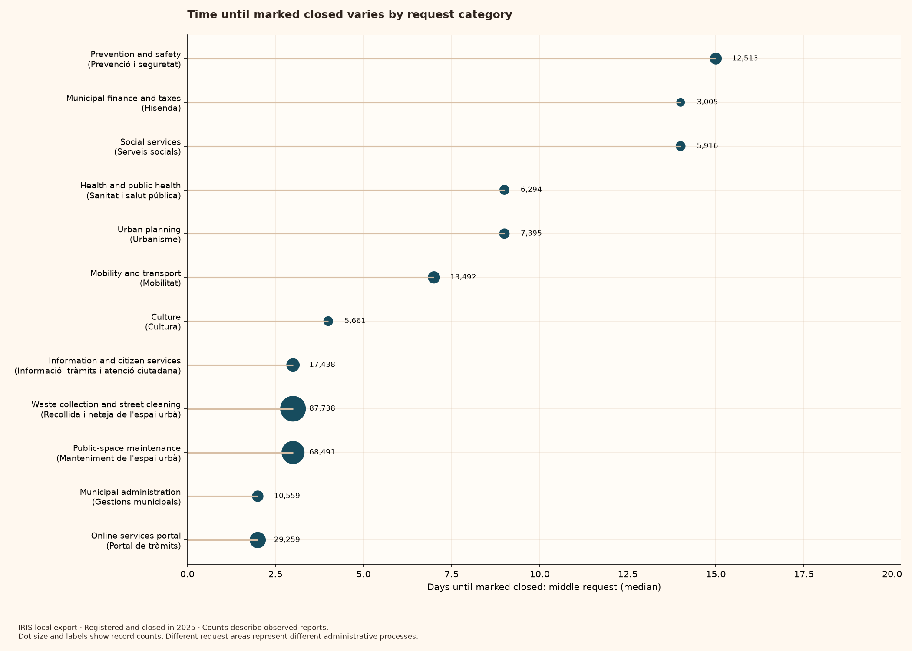

**Takeaway: A single citywide closure-time figure cannot describe every kind of request fairly.**

*How to read it: Each row is a request category, labelled in English and the original language. A dot farther right means more days between registration and being marked closed for the middle request in that category (the median). Larger dots and their numbers mean more requests, not longer times. The chart covers the 12 most frequent categories.*

Cleaning has a median recorded lag of 3 days, and maintenance 3 days. Mobility (Mobilitat) has a median of 7 days, and prevention and safety (Prevenció i seguretat) 15 days. The categories with the largest volumes are not automatically those with the longest medians.

A question about a procedure and a report needing investigation need not follow the same administrative path. Looking at them separately makes the citywide median more understandable and gives us a fairer starting point for asking which processes might need closer study.

This is not a league table of good and bad service. The records do not make complexity, urgency, staffing, or the meaning of closure comparable across areas. The plot supports a question about differences in process; it does not identify their cause.

### 12. Daily request counts and time until closure

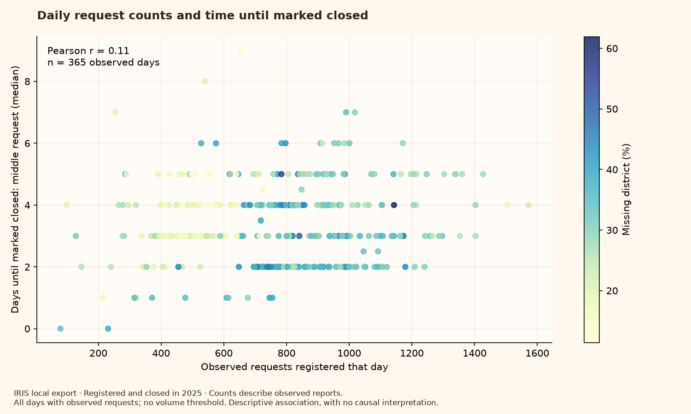

**Takeaway: Knowing how many reports arrived on a day tells us little about their typical recorded closure time in this comparison.**

*How to read it: Each dot represents the requests registered on one day. Further right means more requests arrived that day. Higher means more days passed before the middle request in that group was marked closed (the median). Colour shows the percentage without a recorded district.*

Across 365 observed days, the correlation is 0.11. This measure describes how consistently the two quantities move together in a straight-line pattern. A value close to zero, as here, indicates little such alignment; the dots do not form a clear rising line.

It is understandable to wonder whether more incoming requests mean longer waits. Here, the number of requests registered in a day gives little indication of the time until the middle request in that group was marked closed. That directs attention to more specific questions about the kinds of requests received and the processes they enter.

The vertical axis is not how long that day's workload took to clear, and the plot does not measure backlog or staffing. Daily medians can hide long individual lags. Calendar effects, request mix, and the closure-year cutoff remain unadjusted, so a weak correlation cannot prove that workload has no effect.

### 13. Changing category names can mislead comparisons over time

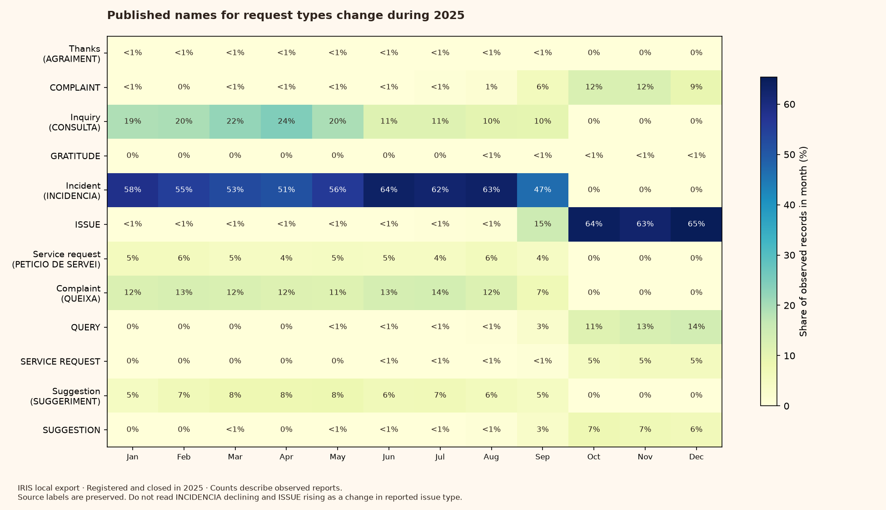

**Takeaway: A change in published labels can look like a change in city problems unless we check the definitions.**

*How to read it: Rows keep each published request-type label separate, with an English reading label where needed; columns are registration months. Each cell is that label's share of the month's records. A <1% label indicates a small nonzero share.*

October contains 0 records labelled INCIDENCIA and 17,071 labelled ISSUE. Other apparent Catalan/English counterparts shift as well, and October–December uses the English labels. The timing suggests a change in publication or classification, although this file does not explain it.

Without checking the labels, we could tell a dramatic story about one type of problem disappearing and another surging. Looking closely protects the people and services represented here from a conclusion the records cannot support. Sometimes the most useful finding is that a comparison needs more work.

We preserve both labels and do not merge apparent translations without a documented mapping. They do not identify the language used by citizens. Before using request-type trends to describe changes in city life, we need the publisher's explanation and a check that the categories remained comparable.

<!-- END IRIS PLOT READINGS -->

## Cost of living vs. quality of life: a neighbourhood view

**Higher rent does not always come with higher resident satisfaction.** This
comparison places all **73 neighbourhoods** using two official 2025 sources:
monthly contractual rent and residents’ satisfaction with living in their
neighbourhood. These are useful proxies, not complete measures of living costs
or quality of life.

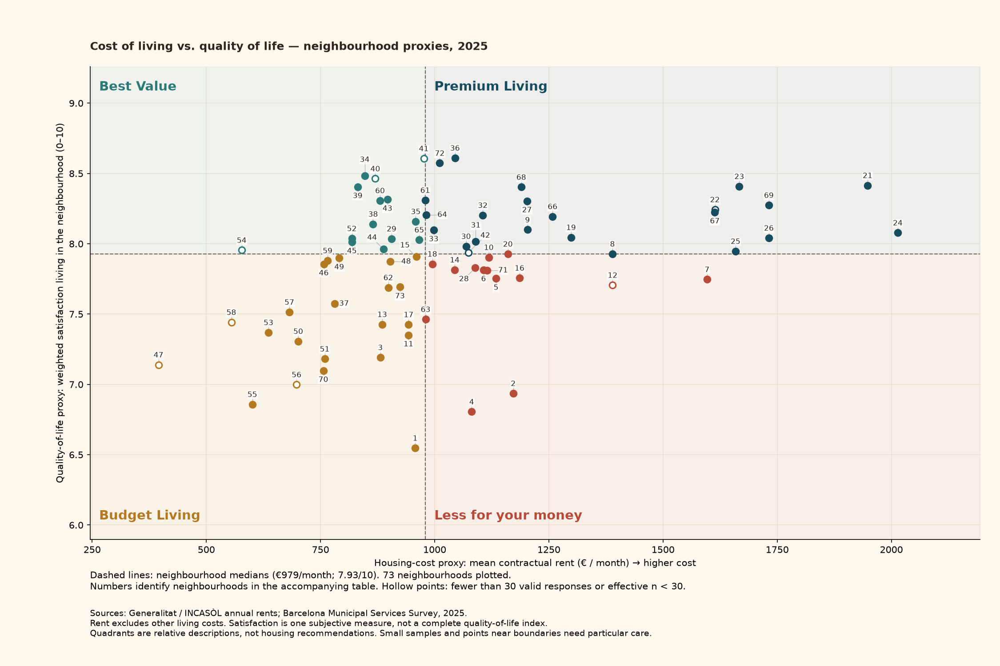

**How to read it:** right means higher rent; up means higher satisfaction.
The dashed lines mark the middle neighbourhood on each measure:
**€979.20/month** and **7.93 out of 10**. Numbers identify neighbourhoods in the
[complete lookup table](reports/neighbourhood_living.md#every-neighbourhood-and-its-evidence).

| Quadrant | What it means relative to those dividing lines | Neighbourhoods |
| --- | --- | ---: |
| Premium Living | Higher rent, higher satisfaction | 23 |
| Best Value | Lower rent, higher satisfaction | 14 |
| Less for your money | Higher rent, lower satisfaction | 14 |
| Budget Living | Lower rent, lower satisfaction | 22 |

For example, **Sant Andreu (60)** combines about **€880/month** with a
satisfaction score of **8.31/10**, placing it in Best Value. **Pedralbes (21)**
has about **€1,948/month** and **8.42/10**, placing it in Premium Living.
The comparison invites a practical question: what does a higher housing budget
buy, and which qualities of a place matter to you?

**Read the boundaries with care.** Nine hollow points flag small survey samples;
some neighbourhood estimates use only five valid answers. Nearby points and
points near the dividing lines should not be treated as clearly different.
“Budget Living” means lower rent in this comparison, not affordable for every
household. Rent excludes other living costs and depends on the homes rented;
satisfaction captures one subjective aspect of life. These are exploratory
estimates from official survey responses, not official neighbourhood rankings
or housing recommendations. No IRIS complaint counts enter either axis.

The [reading guide, all 73 names, sample sizes and methods](reports/neighbourhood_living.md)
links the original sources and explains the weighting. Reproduce this separate
plot with `python -m src.neighbourhood_quadrants --download`; the option downloads
missing source files only (the historical survey CSV is approximately 570 MB).
Existing raw files are preserved. The chart also has a
[source manifest](reports/neighbourhood_living_manifest.json).

## Reproduce the analysis

Use Python 3.11 and the existing dependencies:

```bash
python3.11 -m venv .venv
source .venv/bin/activate
python -m pip install -r requirements.txt
```

For the data already present in this workspace, regenerate everything visible:

```bash
python -m src.explore_iris_signals --readme-path README.md
python -m streamlit run streamlit_app.py
```

The analysis command validates the prepared schema, IDs, dates and closure
lags, then writes:

- the marked plot tour in `README.md` — all 13 figures and their interpretations;
- `reports/iris_signal_summary.md` — the same readings with supporting tables;
- `reports/iris_exploration.html` — a standalone report with embedded plots and CSVs;
- `reports/figures/` — 13 PNG plots;
- `data/processed/summaries/` — 13 aggregate CSVs, ignored by Git;
- `reports/iris_analysis_manifest.json` — input fingerprints, versions, and rules.

The README uses relative Markdown image paths, so GitHub can display every
plot directly when the README and PNGs are committed together. No running app,
external image host, or notebook execution is needed to read the plots.
Raw data, processed record-level data, and regenerated aggregate CSVs stay out
of Git. Aggregate tables are also embedded in the standalone report.

The plot interpretations live in `src/iris_interpretations.py`. The command
above recomputes the quoted numbers and updates only the marked plot section
of the README, preserving the introduction and setup instructions. Omit
`--readme-path` to regenerate the reports without editing the README.
The prose describes this inspected snapshot; review its interpretation when
changing source data.

To work from a fresh checkout, first discover and inspect the source:

```bash
python -m src.data_catalog
python -m src.data_catalog --download efc9fd4d-a812-427c-846d-a086d22012a4
python -m src.inspect_data data/raw/2025_IRIS_Peticions_Ciutadanes_OpenData.csv
python -m src.profile_iris data/raw/2025_IRIS_Peticions_Ciutadanes_OpenData.csv
python -m src.investigate_iris_quality data/raw/2025_IRIS_Peticions_Ciutadanes_OpenData.csv
python -m src.prepare_iris_dataset data/raw/2025_IRIS_Peticions_Ciutadanes_OpenData.csv
python -m src.explore_iris_signals --readme-path README.md
```

The download command refuses to overwrite an existing raw file. Catalog
metadata and download provenance are in [iris_catalog.md](reports/iris_catalog.md).
If the portal is unavailable, preserve an original CSV downloaded from the
[IRIS dataset page](https://opendata-ajuntament.barcelona.cat/data/en/dataset/iris)
in `data/raw/`, then inspect it before preparing data. A fresh remote download
may differ from this preserved snapshot; regenerate and inspect the outputs.

Output paths are configurable with `python -m src.explore_iris_signals --help`.
The current analysis explicitly expects the inspected **2025 closure-year**
schema and rejects inconsistent dates or duplicate identifiers.

Run the lightweight analytical and interface checks:

```bash
python -m unittest discover -s tests -v
python -m compileall -q src streamlit_app.py
```

## Project structure

```text
data/raw/                 Original downloads, never edited in place
data/processed/           Prepared records, summaries, and local caches
reports/figures/           Exported scientific/descriptive plots
reports/*.md              Profiles, decisions, and generated reading guide
reports/*.html            Standalone illustrated report
reports/*.json            Reproducibility manifest
src/iris_signals.py        Shared cohort, calendar, and composition calculations
src/explore_iris_signals.py CLI and static plots
src/iris_interpretations.py Per-plot narratives shared across all reading formats
src/iris_report.py         Markdown, offline HTML, and README narrative generation
src/*                     Discovery, inspection, quality, and preparation
streamlit_app.py           Existing local explorer over the same calculations
tests/                    Calendar, denominator, input, and interface regressions
```

## Reproduce the follow-up audit

For the dated files already present locally:

```bash
python -m src.audit_iris_observation
```

On a fresh checkout, preserve the catalog and later export before inspecting it:

```bash
python -m src.data_catalog --catalog-output data/raw/iris_catalog_2026-10-02.json --download eae9a19a-4543-45db-bc13-3e3073b58324 --download-path data/raw/2026_IRIS_Peticions_Ciutadanes_OpenData_2026-10-02.csv
python -m src.inspect_data data/raw/2026_IRIS_Peticions_Ciutadanes_OpenData_2026-10-02.csv
python -m src.profile_iris data/raw/2026_IRIS_Peticions_Ciutadanes_OpenData_2026-10-02.csv --report-path reports/iris_2026_profile.md --daily-output-path data/processed/iris_2026_daily_raw.csv
python -m src.audit_iris_observation
```

The snapshot names above identify the inspected inputs, not a historical
version supplied by the server. A download made later may have different
contents; use its actual date in new filenames, pass them with `--later-raw`
and `--catalog`, and inspect it before rerunning the audit. Downloads refuse
to overwrite existing files and install only complete responses.

The audit writes its four CSVs, including the combined observed records under
`data/processed/observation_audit/`, plus a Markdown report, source fingerprints,
and the comparison plot. It does not replace the original explorer's dataset.

## Next according to the plan

The observation-window audit is complete for the two preserved snapshots.
Request-type translations remain unverified: the catalog defines the field
but provides no mapping of its values. Two new area labels and many new detail
labels also mean that category comparisons need care.

Next, select and inspect a Barcelona weather source for a narrow question:
are daily weather conditions associated with the number of observed cleaning
requests that close within 30 days? Check a 90-day definition and weekday/month
differences. The cleaning area's published name is shared by both exports;
that alone does not prove that classification practice was unchanged.
No weather data has been joined and no weather effect is established yet.
See [PROJECT_PLAN.md](PROJECT_PLAN.md) for the remaining work.
