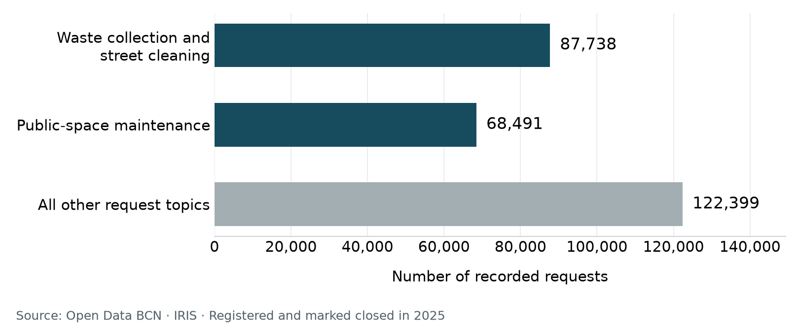
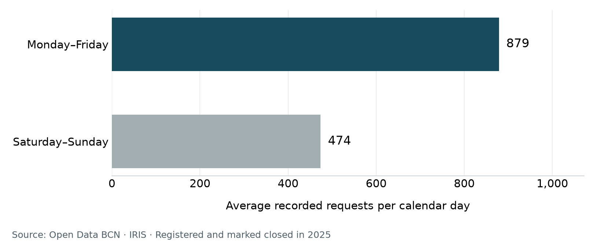
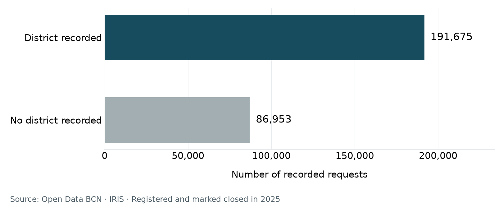
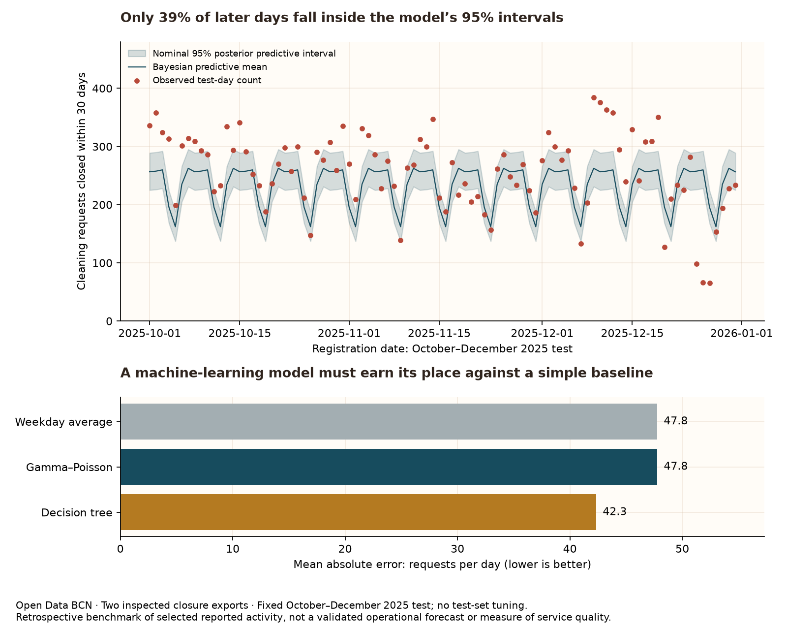
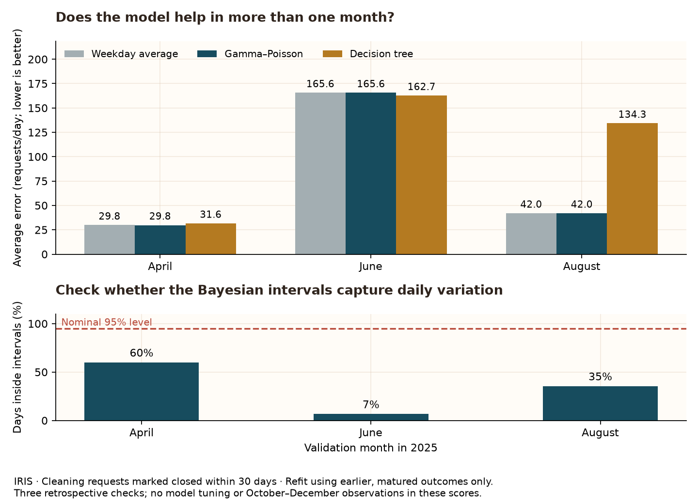

# Barcelona Urban Life Signals

**What can citizen requests tell us about Barcelona—and what do the records leave out?**

Built on my **Master’s in Data Science, Statistics and Decision Analysis**,
this Python project turns Barcelona City Council’s public request records into
reproducible analysis. I examine reporting patterns and missing information
before drawing conclusions that could affect how we understand residents’ needs.

**Python · pandas · scikit-learn · Bayesian inference · Matplotlib · automated tests**

[Full analysis](reports/iris_signal_summary.md) ·
[Downloadable report](reports/iris_exploration.html) ·
[Run the project](REPRODUCING.md)

## The data, in plain terms

[IRIS, published by Open Data BCN](https://opendata-ajuntament.barcelona.cat/data/en/dataset/iris),
records contact with the council: incidents, complaints, inquiries, suggestions
and thanks. One row represents a request, not necessarily one person or one problem.

The preserved 2025 file contains **287,304 rows**. Removing **3,393 exact duplicates**
leaves **283,911 records**. The main analysis uses **278,628 requests registered
and marked closed in 2025**. Earlier registrations stay in the prepared data.

**Marked closed is an administrative status, not proof that an issue was fixed.**
Requests still open or closed in another year are missing from this view.

## From coursework to evidence

My training in **Machine Learning, Data Mining, Statistical Modelling and
Bayesian Learning** informs how I approach the data:

- **Prepare before predicting.** I preserve raw files, remove exact duplicates
  and validate dates and identifiers. [Preparation code](src/prepare_iris_dataset.py).
- **Check what a comparison measures.** I calculate averages per calendar day,
  retain missing locations and investigate year-end selection.
  [Analysis code](src/iris_signals.py) · [Observation audit](reports/iris_observation_windows.md).
- **Test predictions on later dates.** Compare a decision tree and a Bayesian
  count model with a weekday-average baseline. Check prediction errors,
  uncertainty and sensitivity to assumptions. [Model code](src/model_iris_counts.py).
- **Make the work verifiable.** Shared calculations generate plots and reports;
  [tests](tests/) and [source fingerprints](reports/iris_model_manifest.json)
  support reproducibility.

[How the four courses connect to implemented work](reports/course_to_project.md).

<!-- BEGIN IRIS PLOT READINGS -->

## Three findings

These charts use **278,628 requests registered and marked closed in 2025**. They describe contact with the council, not every problem in the city.

### 1. Cleaning and maintenance account for 56% of requests



**156,229 requests concern the upkeep of shared public spaces.** The bars count requests by topic; “all other” combines the remaining categories.

Streets and pavements are part of everyday life. Their prominence identifies a concrete topic for further study. **More reports do not necessarily mean more severe problems:** several requests may concern the same issue.

### 2. Weekdays average 1.9 times as many requests as weekends



**879 requests per weekday, compared with 474 per weekend day.** Each total is divided by the number of days in its group, so five weekdays are not compared directly with two weekend days.

When assessing a busy day, compare it with similar weekdays first. **This measures when requests enter IRIS**, not when problems begin or why people choose to report.

### 3. 31% of requests have no recorded district



**A district-only map would leave out 86,953 requests.** Keeping those records visible prevents a partial map from looking like a complete account.

Some requests concern administrative services rather than a specific place. **Missing district does not automatically mean an error**, and district counts cannot rank neighbourhood quality.

[Explore all 13 plots, English category labels and detailed interpretations](reports/iris_signal_summary.md).

<!-- END IRIS PLOT READINGS -->

<!-- BEGIN IRIS MODEL FINDINGS -->

## Predicting requests means testing uncertainty, too

This experiment uses **cleaning requests marked closed within 30 days**, combining
the two audited exports. It is a different group from the descriptive charts above.



**The Bayesian model’s nominal 95% intervals cover only 39% of test days.**
Its *prior* starts with a broad range of possible daily rates. The *Poisson likelihood*
connects those rates to training counts. The *posterior* updates the rates; the
*posterior predictive distribution* describes possible counts on a new day.
The missed observations show why a precise average is not enough for planning.

On the same October–December test, the **decision tree** misses by an average of
**42.3 requests/day**, versus **47.8** for a simple weekday average
and **47.8** for the Bayesian mean. Lower is better.
Training excludes dates whose 30-day outcomes would not yet be known.
No model was tuned on these test results.

**The tree’s advantage does not hold in the 90-day check:** its average error rises
to 129.6, versus 62.9 for the weekday average.
That check changes both the counted requests and the available training period.

This is a retrospective benchmark of selected reported activity, not a reliable
operational forecast. [See the prior–likelihood–posterior plot, predictive checks,
90-day sensitivity and reproducible methods](reports/iris_model_comparison.md).

<!-- END IRIS MODEL FINDINGS -->

<!-- BEGIN IRIS VALIDATION -->

### Does the model help in more than one month?



The decision tree beats the weekday average in **1 of 3 months**. The Bayesian model’s nominal 95% intervals contain **7%–60%** of daily counts across these months.

This **time-based cross-validation** refits on earlier records before checking April, June and August. It tests whether the findings repeat before anyone relies on them to anticipate busy days. These are retrospective checks, with no retuning. [Read the validation design and limitations](reports/iris_temporal_validation.md).

<!-- END IRIS VALIDATION -->

## A finding that changed the analysis

**December’s observed count rises by 34.2% when later closures are included.**
A separate 2026 export adds 5,331 requests registered in December 2025,
raising that month’s count from 15,600 to 20,931.

The practical lesson: a year-end decline can partly reflect the file’s closing
date rather than fewer concerns. The later snapshot contains closures through
**31 March 2026**; it still does not reveal every open request.
[See the comparison plot and the 30-day/90-day follow-up rules](reports/iris_observation_windows.md).

## Explore further

- **[All 13 IRIS plots](reports/iris_signal_summary.md):** request topics, districts,
  reporting channels and time until marked closed, with English reading labels.
- **[Housing cost and resident satisfaction](reports/neighbourhood_living.md):**
  a separate 2025 comparison of all 73 neighbourhoods. Official rent and survey
  satisfaction are limited proxies; small samples are flagged.
- **[Offline HTML report](reports/iris_exploration.html):** download and open it in
  a browser for charts and downloadable aggregate tables.

For adjustable date, district, topic and channel filters, run the existing
Streamlit explorer locally after following the [setup guide](REPRODUCING.md):

```bash
python -m streamlit run streamlit_app.py
```

The README charts are static images. The explorer provides the filters.

## Reproduce the work

Use **Python 3.11**. The [setup guide](REPRODUCING.md) covers installation,
source downloads and inspection. Raw and processed data are excluded from Git.
With the inspected data prepared locally:

```bash
python -m src.explore_iris_signals --readme-path README.md
python -m src.audit_iris_observation
python -m src.model_iris_counts --readme-path README.md
python -m src.validate_iris_models --readme-path README.md
python -m unittest discover -s tests -v
```

Current scope: descriptive analysis, data-quality checks and retrospective model
evaluation. The models are not validated for operational use. Weather comparisons
remain a separate next step. [Project plan](PROJECT_PLAN.md).
