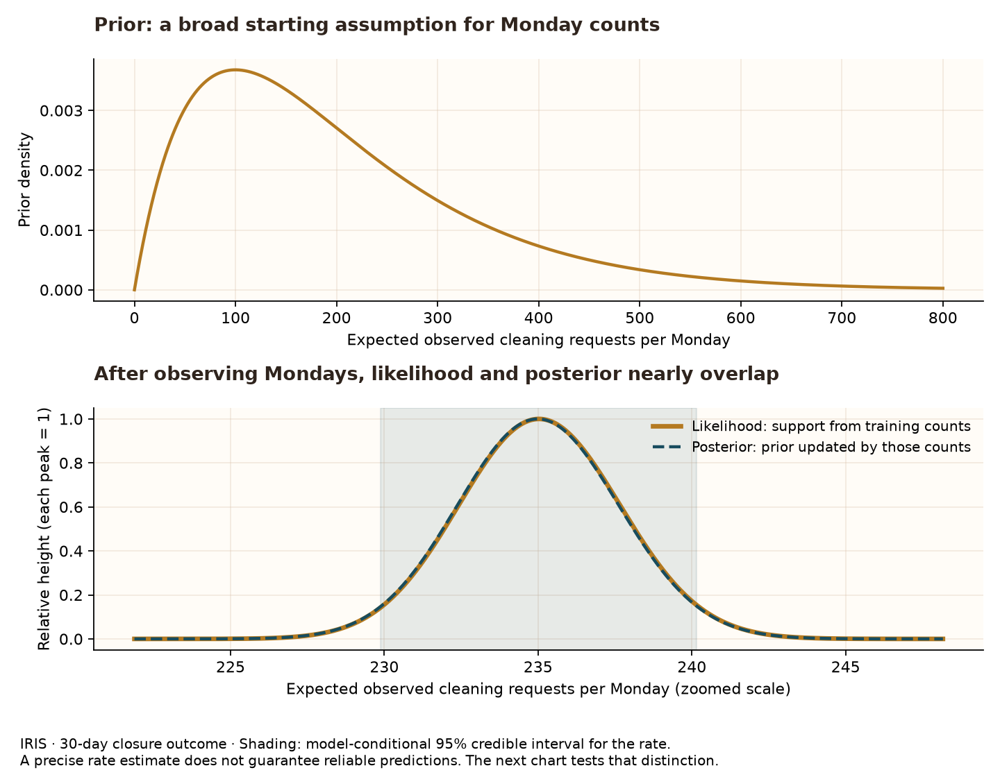

# What the models learn—and what they miss

**Question:** can simple models describe and predict daily observed cleaning requests that are marked closed within 30 days?

## Prior, likelihood and posterior: an actual calculation



The Monday rate changes from a prior mean of 200 to a posterior mean of 235.0 requests per day. The model-conditional 95% credible interval is 229.9–240.1. The likelihood and posterior nearly overlap because the training data outweigh this broad prior. The two panels use different x ranges; the lower curves are each scaled to peak at one. A likelihood curve is not a probability distribution over the rate.

For each weekday separately, daily counts are assumed conditionally independent Poisson(lambda). The prior is Gamma(shape=2, rate=0.01), with mean 200 and SD about 141. It is an illustrative assumption, not elicited knowledge. After n training days with S total requests, the posterior is Gamma(2 + S, 0.01 + n). NumPy uses a scale parameter, so the implementation passes 1/rate. The posterior predictive distribution mixes Poisson counts over Gamma rate draws, incorporating both rate uncertainty and observation variability.

## Test the uncertainty, not just the central estimate


Only **39.1%** of the 92 test days fall inside the nominal 95% predictive intervals. A narrow credible interval for a mean rate is therefore not evidence that daily counts are well predicted. Unexpected reporting spikes matter if someone uses the estimates to anticipate incoming requests. The interval check makes this limitation visible before any operational use.

| horizon_days | model           | test_days | MAE    | RMSE   |
| ------------ | --------------- | --------- | ------ | ------ |
| 30           | Weekday average | 92        | 47.76  | 60.17  |
| 30           | Gamma–Poisson   | 92        | 47.76  | 60.17  |
| 30           | Decision tree   | 92        | 42.34  | 55.83  |
| 90           | Weekday average | 92        | 62.94  | 75.6   |
| 90           | Gamma–Poisson   | 92        | 62.94  | 75.6   |
| 90           | Decision tree   | 92        | 129.57 | 146.33 |

MAE is the average absolute difference between predicted and observed requests per day; RMSE gives larger misses more weight. The weekday-average baseline and Bayesian predictive means are almost identical because the prior has little influence. The decision tree can learn calendar splits, but extra flexibility need not improve performance on later dates.

## Design fixed before inspecting test performance

Outcome: exact published AREA label “Recollida i neteja de l’espai urbà” in the two audited exports, registration dates in 2025, and closure lag <=30 days including zero and day 30. All 365 calendar dates are retained; a zero means zero qualifying records observed in these snapshots. Unknown unpublished records and still-open requests remain outside the target.

Forecast origin: 2025-10-01. Test: all October–December dates. Train only on dates whose full closure window ends **before** the origin: January–August for 30 days. September is excluded from training to prevent immature labels. Models are fitted once and held fixed throughout the test. The 90-day sensitivity uses the same origin and test dates, with training ending July 2 so every training outcome has matured. It changes both the target and training length; it is not a pure comparison of follow-up periods. Neither run was used for tuning.

Calendar features known in advance: weekday (0–6) and day of year. DecisionTreeRegressor uses max_depth=3, min_samples_leaf=14 and a fixed seed; no scaling, target-derived features or activation function is required. The tree uses squared-error splits and cannot extrapolate seasonal trends beyond its training range. There is no hyperparameter search and no independent replication across years.

This is a **retrospective temporal benchmark**, not a reconstruction of data available in production on that day: the exports were downloaded later, so revisions and publication delays are not known. The recorded-date maturity rule prevents one kind of label leakage; it cannot establish historical publication availability.

## Data mining and posterior predictive checks

Training counts are profiled by weekday. Compare their variance-to-mean ratio with 4,000 replicated training samples from the fitted Gamma–Poisson model. Each replicate shares a sampled rate across its days. A much larger observed ratio indicates variation the constant weekday-rate model does not reproduce; it does not identify a cause. The replicate exceedance counts are simulation diagnostics, not classical significance tests.

| weekday | observed_variance_to_mean | replicated_dispersion_95th | replicates_at_least_observed | replicates |
| ------- | ------------------------- | -------------------------- | ---------------------------- | ---------- |
| 0       | 41.73                     | 1.44                       | 0                            | 4000       |
| 1       | 36.73                     | 1.44                       | 0                            | 4000       |
| 2       | 39.0                      | 1.44                       | 0                            | 4000       |
| 3       | 58.93                     | 1.45                       | 0                            | 4000       |
| 4       | 64.92                     | 1.44                       | 0                            | 4000       |
| 5       | 28.48                     | 1.43                       | 0                            | 4000       |
| 6       | 21.49                     | 1.43                       | 0                            | 4000       |

## Prior sensitivity and simulation accuracy

Repeat the conjugate update with shape 2 and prior means 50, 200 and 500. These priors all have small effective exposure relative to the training data, so this is a limited sensitivity check, not proof that every prior would agree.

| weekday | prior_mean | posterior_mean |
| ------- | ---------- | -------------- |
| 0       | 50         | 234.81         |
| 0       | 200        | 235.02         |
| 0       | 500        | 235.06         |
| 1       | 50         | 262.25         |
| 1       | 200        | 262.48         |
| 1       | 500        | 262.53         |
| 2       | 50         | 256.28         |
| 2       | 200        | 256.5          |
| 2       | 500        | 256.54         |
| 3       | 50         | 257.39         |
| 3       | 200        | 257.61         |
| 3       | 500        | 257.66         |
| 4       | 50         | 259.59         |
| 4       | 200        | 259.81         |
| 4       | 500        | 259.86         |
| 5       | 50         | 195.43         |
| 5       | 200        | 195.6          |
| 5       | 500        | 195.63         |
| 6       | 50         | 161.99         |
| 6       | 200        | 162.13         |
| 6       | 500        | 162.15         |

Each weekday uses 50,000 seeded Gamma draws and corresponding Poisson draws for intervals. Point forecasts use exact posterior means. The table below records Monte Carlo standard error of each simulated mean. Interval endpoints also have simulation error; the fixed seed makes the displayed results reproducible.

| weekday | train_days | sum_counts | posterior_shape | posterior_rate | posterior_mean | rate_low | rate_high | predictive_low | predictive_high | mc_mean_standard_error |
| ------- | ---------- | ---------- | --------------- | -------------- | -------------- | -------- | --------- | -------------- | --------------- | ---------------------- |
| 0       | 34         | 7991       | 7993.0          | 34.01          | 235.019        | 229.871  | 240.142   | 205            | 266             | 0.012                  |
| 1       | 34         | 8925       | 8927.0          | 34.01          | 262.482        | 257.097  | 267.948   | 231            | 295             | 0.012                  |
| 2       | 35         | 8978       | 8980.0          | 35.01          | 256.498        | 251.206  | 261.848   | 225            | 289             | 0.012                  |
| 3       | 35         | 9017       | 9019.0          | 35.01          | 257.612        | 252.325  | 262.98    | 226            | 290             | 0.012                  |
| 4       | 35         | 9094       | 9096.0          | 35.01          | 259.811        | 254.474  | 265.177   | 228            | 292             | 0.012                  |
| 5       | 35         | 6846       | 6848.0          | 35.01          | 195.601        | 191.015  | 200.249   | 168            | 224             | 0.011                  |
| 6       | 35         | 5674       | 5676.0          | 35.01          | 162.125        | 157.911  | 166.376   | 137            | 188             | 0.01                   |

## Inspect the fitted tree

```text
|--- day_of_year <= 152.50
|   |--- weekday <= 4.50
|   |   |--- day_of_year <= 128.50
|   |   |   |--- value: [187.07]
|   |   |--- day_of_year >  128.50
|   |   |   |--- value: [229.94]
|   |--- weekday >  4.50
|   |   |--- weekday <= 5.50
|   |   |   |--- value: [158.86]
|   |   |--- weekday >  5.50
|   |   |   |--- value: [131.27]
|--- day_of_year >  152.50
|   |--- day_of_year <= 199.50
|   |   |--- day_of_year <= 180.50
|   |   |   |--- value: [337.43]
|   |   |--- day_of_year >  180.50
|   |   |   |--- value: [464.84]
|   |--- day_of_year >  199.50
|   |   |--- weekday <= 4.50
|   |   |   |--- value: [277.27]
|   |   |--- weekday >  4.50
|   |   |   |--- value: [189.64]
```

## Reproduce

```bash
python -m src.audit_iris_observation
python -m src.model_iris_counts --readme-path README.md
```

The original descriptive charts still use the 2025 closure-year group. These model results use the separate combined-export, fixed-window cleaning outcome. No weather effect, causality or citywide demand claim is made. Next: investigate time-varying rates and overdispersion using validation periods chosen within training data. Treat this test quarter as already seen in any further development.

[Decision tree reference](https://scikit-learn.org/stable/modules/generated/sklearn.tree.DecisionTreeRegressor.html) · [NumPy Gamma draws](https://numpy.org/doc/stable/reference/random/generated/numpy.random.Generator.gamma.html) · [NumPy Poisson draws](https://numpy.org/doc/stable/reference/random/generated/numpy.random.Generator.poisson.html). Inputs and settings: [manifest](iris_model_manifest.json). Aggregate outputs: data/processed/models/.
