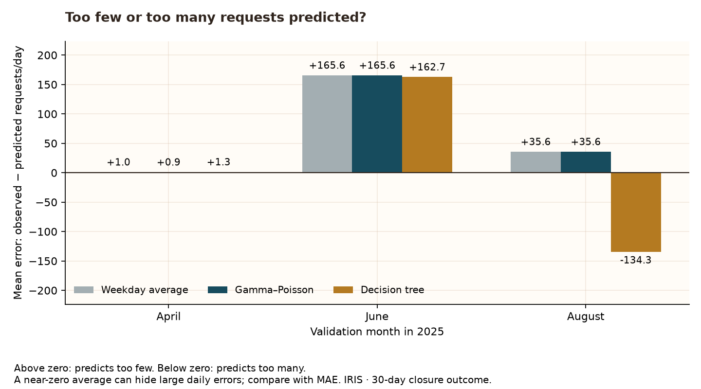

# Does the model help in more than one month?


The decision tree beats the weekday average in **1 of 3 months**. The Bayesian model’s nominal 95% intervals contain **7%–60%** of daily counts across these months.

A model that works in one period may disappoint in another. For someone anticipating contact with the council, average accuracy and room for busy days both matter. These checks assess repeatability; they do not establish readiness for staffing decisions.

June is difficult for all three models: average errors range from 162.7 to 165.6 requests per day. The tree’s small advantage that month does not make those predictions reliable. These scores do not explain the cause of the misses.

## How to read the chart

Top: each bar is the average absolute prediction error (MAE), in requests per day. A lower bar means smaller misses in that month. Bottom: the share of actual daily counts inside the Bayesian posterior predictive intervals. The dashed line marks their nominal 95% level. Three months offer a diagnostic, not a precise estimate of future performance.

| Month  | Model           | Validation days | MAE    | RMSE   |
| ------ | --------------- | --------------- | ------ | ------ |
| April  | Weekday average | 30              | 29.84  | 40.03  |
| April  | Gamma–Poisson   | 30              | 29.83  | 40.03  |
| April  | Decision tree   | 30              | 31.65  | 42.71  |
| June   | Weekday average | 30              | 165.6  | 183.08 |
| June   | Gamma–Poisson   | 30              | 165.58 | 183.07 |
| June   | Decision tree   | 30              | 162.68 | 179.73 |
| August | Weekday average | 31              | 42.04  | 50.7   |
| August | Gamma–Poisson   | 31              | 42.05  | 50.7   |
| August | Decision tree   | 31              | 134.26 | 143.4  |

## Applied Machine Learning: time-based cross-validation

Refit the same three models separately before April, June and August. Each training window begins January 1 and expands to include only dates whose full 30-day closure window ended before the validation month. Keep every calendar day, including zero counts. Evaluate the entire next selected month. Earlier validation months may enter a later training window once their outcomes mature. The windows therefore overlap in training, and scores are not independent experimental replicates.

| Month  | Train through | Training days | Validation start | Validation end | Validation days | Coverage (%) |
| ------ | ------------- | ------------- | ---------------- | -------------- | --------------- | ------------ |
| April  | 2025-03-01    | 60            | 2025-04-01       | 2025-04-30     | 30              | 60.0         |
| June   | 2025-05-01    | 121           | 2025-06-01       | 2025-06-30     | 30              | 6.7          |
| August | 2025-07-01    | 182           | 2025-08-01       | 2025-08-31     | 31              | 35.5         |

The model settings and features are unchanged from the original benchmark. No search, ranking-based selection or retuning follows these results. The three windows were fixed before calculating these scores, but this follow-up was designed after the original October–December results were seen. It is not a new untouched test. September–December observations are excluded from these fits and scores.

## Which way do the models miss?



The weekday average predicts too few requests on **30 of 30 June days**. The tree predicts too many on **31 of 31 August days**.

This **residual analysis** uses observed minus predicted counts on validation days. Positive errors mean the model predicts too few requests; negative errors mean too many. The bars average those signed errors within each month. No model is refitted or selected using these diagnostics.

For the weekday average in April, the mean signed error is only **+1.0** requests per day, while MAE is **29.8**. Overpredictions and underpredictions nearly cancel in the signed average. A small mean error does not imply accurate daily predictions.

| Month  | Model           | Days | Underpredicted days | Overpredicted days | Exact days | Mean error | MAE    |
| ------ | --------------- | ---- | ------------------- | ------------------ | ---------- | ---------- | ------ |
| April  | Weekday average | 30   | 16                  | 14                 | 0          | 0.98       | 29.84  |
| April  | Gamma–Poisson   | 30   | 16                  | 14                 | 0          | 0.95       | 29.83  |
| April  | Decision tree   | 30   | 16                  | 14                 | 0          | 1.27       | 31.65  |
| June   | Weekday average | 30   | 30                  | 0                  | 0          | 165.6      | 165.6  |
| June   | Gamma–Poisson   | 30   | 30                  | 0                  | 0          | 165.58     | 165.58 |
| June   | Decision tree   | 30   | 30                  | 0                  | 0          | 162.68     | 162.68 |
| August | Weekday average | 31   | 27                  | 4                  | 0          | 35.6       | 42.04  |
| August | Gamma–Poisson   | 31   | 27                  | 4                  | 0          | 35.6       | 42.05  |
| August | Decision tree   | 31   | 0                   | 31                 | 0          | -134.26    | 134.26 |

Underpredicted, overpredicted and exact days partition each validation month. Directions use unrounded forecasts; the table rounds summaries for reading. These are descriptive errors on the selected request counts, not statistical significance tests. Persistent underprediction could leave a team unprepared, while overprediction could reserve capacity unnecessarily. Actual staffing consequences require workload and cost data that this project does not have. The error directions alone do not identify weather effects, overfitting or the cause of the changes.

## What the data can support

The outcome remains observed cleaning/collection requests registered in 2025 and marked closed within 30 days in the two preserved exports. It is neither total demand nor proof of successful repairs. Historical publication delays and revisions are unknown; date-based label maturity cannot recreate exactly what data would have been available then. No weather effect or cause of model errors is identified.

Keep the weekday average as a reference in the planned weather comparison. Any more flexible model should be evaluated with time-aware validation, with a fresh final test required for new performance claims.

## Reproduce

```bash
python -m src.validate_iris_models --readme-path README.md
```

Requires the existing observation audit. No new download or dependency. [Code](../src/validate_iris_models.py) · [Settings and fingerprint](iris_validation_manifest.json) · [Original model comparison](iris_model_comparison.md).
