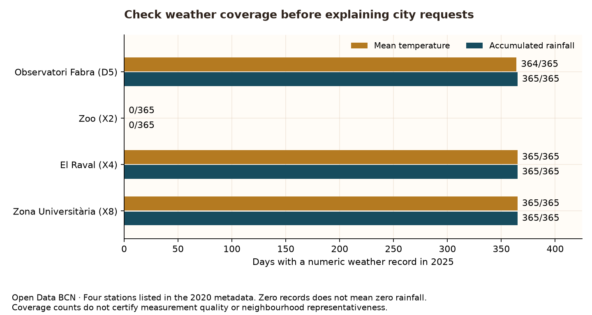

# Weather context starts with trustworthy joins

Rain and heat are plausible context for public-space concerns. Before asking whether they coincide with reported requests, establish what the weather files actually measure.



| Station | Variable             | Unit | Recorded days | Numeric days | Absent dates | Null values |
| ------- | -------------------- | ---- | ------------- | ------------ | ------------ | ----------- |
| D5      | Mean temperature     | °C   | 364           | 364          | 1            | 0           |
| D5      | Accumulated rainfall | mm   | 365           | 365          | 0            | 0           |
| X2      | Mean temperature     | °C   | 0             | 0            | 365          | 0           |
| X2      | Accumulated rainfall | mm   | 0             | 0            | 365          | 0           |
| X4      | Mean temperature     | °C   | 365           | 365          | 0            | 0           |
| X4      | Accumulated rainfall | mm   | 365           | 365          | 0            | 0           |
| X8      | Mean temperature     | °C   | 365           | 365          | 0            | 0           |
| X8      | Accumulated rainfall | mm   | 365           | 365          | 0            | 0           |

Bars count dates with numeric values, not rainy days. Zoo is present only in the older station metadata; zero observations is not evidence of dry weather or proof that the station was inactive. Fabra temperature has absent dates: 2025-09-30.

## Data Mining: inspect the grain before joining

The daily export has **16,396 rows** and five columns. Its unique key is date + station + variable. Station metadata has **51 sensor rows**, describing **4 station identities**. Joining it on station code alone would produce **245,940 rows**, repeating observations. The audit checks station identity consistency, reduces metadata to one identity per station and enforces many-to-one joins. Missing calendar records stay missing, never zero-filled.

Weather columns: `DATA_LECTURA`, `DATA_EXTREM`, `CODI_ESTACIO`, `ACRÒNIM`, `VALOR`. `DATA_LECTURA` is the daily label; `DATA_EXTREM` supplies an extreme-value time where present. A missing extreme time is not itself a missing daily temperature or rainfall measurement.

| CODI_VARIABLE | NOM_VARIABLE                  | UNITAT | ACRÒNIM |
| ------------- | ----------------------------- | ------ | ------- |
| 1000          | Temperatura mitjana diària    | °C     | TM      |
| 1300          | Precipitació acumulada diària | mm     | PPT     |

## Station choice and limits

| Station | Published name                 | Altitude (m) | Latitude | Longitude |
| ------- | ------------------------------ | ------------ | -------- | --------- |
| D5      | Barcelona - Observatori Fabra  | 411          | 41.41864 | 2.12379   |
| X2      | Barcelona - Zoo                | 7            | 41.38943 | 2.18847   |
| X4      | Barcelona - el Raval           | 33           | 41.3839  | 2.16775   |
| X8      | Barcelona - Zona Universitària | 79           | 41.37919 | 2.1054    |

El Raval (X4) is the provisional primary station for the next city-level comparison: its published location is urban and both selected variables cover 365 dates. Zona Universitària (X8) offers a second complete series for sensitivity checks. Fabra sits at a different elevation and has one temperature gap. This choice does not make any station representative of all 73 neighbourhoods. The 2020 metadata cannot certify unchanged locations, sensors or operating status in 2025.

The export contains no measurement-quality/representativeness flag. [Meteocat describes such flags for its daily XEMA source](https://www.meteo.cat/wpweb/serveis/dades-obertes/). Record presence therefore cannot be treated as a quality certificate. The exact daily aggregation boundary and time zone are not established by these three files. Verify them before aligning weather with IRIS registration dates; do not infer a local calendar day from a date-only label.

## Next comparison, not a result yet

After resolving day alignment and quality provenance, join one selected station-day to the full IRIS daily calendar with one-to-one validation. Keep missing weather visible and use a second station as a sensitivity check. Any association analysis needs weekday/month controls and reporting-channel checks. No weather effect, causal claim or forecast improvement is established here.

## Reproduce and attribute

```bash
python -m src.audit_weather --download --snapshot 2026-10-26 --readme-path README.md
```

Omit `--download` for an offline rebuild. On a later download, use its actual date as `--snapshot`; the server does not guarantee historical file versions. Raw files are never overwritten. Derived calendar and coverage CSVs live in `data/processed/weather/`.

Source: Barcelona City Council / Open Data BCN, meteorological observations attributed to Servei Meteorològic de Catalunya (XEMA). Catalog license: CC BY 4.0. [Measurements](https://opendata-ajuntament.barcelona.cat/data/en/dataset/mesures-estacions-meteorologiques) · [Variable definitions](https://opendata-ajuntament.barcelona.cat/data/en/dataset/metadades-variables-est-meteo) · [Stations](https://opendata-ajuntament.barcelona.cat/data/en/dataset/metadades-estacions-meteorologiques) · [Fingerprints and schemas](weather_manifest.json) · [Audit code](../src/audit_weather.py).
